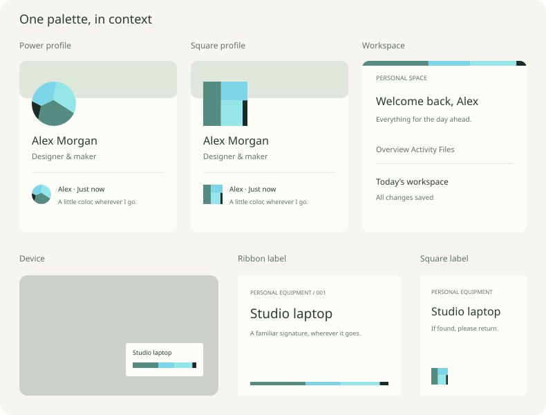

# Ribbons

Color as identity: choose a main color and generate a small, weighted palette for a profile, a device, or anything else that needs a recognizable mark.

[Open the playground](https://lynzrand.github.io/ribbons/)


## Use the playground

1. Pick a main color in the OKLab picker, or click **Random identity** for a new color and style.
2. Adjust contrast and segment count. Open **Options** to tune primary and chroma affinity. Previews update as you edit; choose a variation to explore another palette.
3. Switch layouts and open **In context** to see profiles, a workspace, device markings, and labels.
4. Copy individual colors or the whole palette, export SVG or palette JSON, or name and save the identity in your browser.

For repeatable results, enter a seed and keep the same parameters. **Parameters from seed** derives the main color and style from that seed with four segments; clear the seed to get a new identity. **Random identity** always starts fresh. Automatic rerolling on parameter changes is available when no fixed seed is entered.


Each row uses the same colors and weights across five styles: a thin ribbon, a square treemap, a circular split, a Power avatar, and a rounded donut.

The examples below use one unchanged palette throughout. Power and square avatars appear at profile and conversation sizes; ribbons mark a workspace, a device, and a label.



## Run locally

Use Node.js 26 and pnpm 12.11.2, matching the project's CI and package manager configuration.

```sh
pnpm install
pnpm dev
```

For a production build:

```sh
pnpm build
pnpm preview
```

## Core library

The playground uses a dependency-free TypeScript library, exposed within this workspace as `@ribbons/core`. It generates palettes and provides the same layouts used in the previews.

```ts
import {
  fromHex,
  generateRibbon,
  randomRibbonOptions,
  sliceAndDice,
  softPreset,
} from '@ribbons/core'

const ribbon = generateRibbon({
  ...softPreset,
  lab: fromHex('#b9dfc9'),
  seed: 'studio-laptop',
})

// Colors and widths share the same order; widths sum to one.
const tiles = sliceAndDice(ribbon.widths, 128, 128)

// Derive both the main color and style from a seed.
const identity = generateRibbon(randomRibbonOptions('account-42'))
```

See the [core exports](packages/ribbon-core/src/index.ts) for color conversions, palette types, and layout functions. `powerSvg` and `donutSvg` return SVG fragments for circular avatars and rounded rings. Blank seeds get a UUID; retain the returned seed and options to reproduce a palette.

## Limits

Reproducing a palette requires the same seed, parameters, and algorithm version. The sampler is experimental, and results may change between versions. Colors are produced for sRGB; generated palettes do not guarantee accessible text or UI contrast. Saved identities stay in the current browser; export JSON to keep a separate copy.

## Contributing

See [CONTRIBUTING.md](CONTRIBUTING.md) for checks, visual preview generation, and deployment details.

## LLM disclosure

An LLM did most of the programming and research for this project, including algorithm exploration, implementation, tests, and literature searches. The human author supplied the original idea, visual references, design direction, and iterative feedback. Treat research conclusions as experimental observations rather than a validated color-harmony model.

## License

ISC, as declared in [package.json](package.json).
