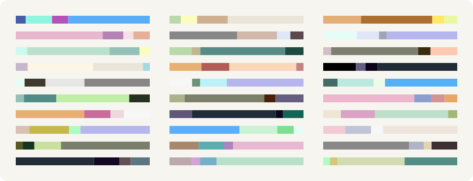
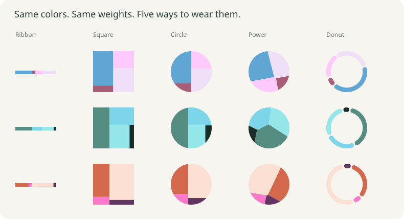

# Ribbons

Color as identity: choose a main color and generate a small, weighted palette for a device, a profile, or anything else that needs a recognizable mark.

[Open the playground](https://lynzrand.github.io/ribbons/)



Pick a color directly in OKLab, then adjust contrast, hue affinity, and chroma affinity. Soft colors can stay pastel; dull colors can stay subdued. Parameters update the previews automatically, with an option to reroll the random seed on every change.

The same colors and weights work as a thin ribbon, a rectangular treemap, or a circular avatar using area-aware splits or a weighted power diagram. Save identities in your browser, reuse their seeds, and export SVG or palette JSON. No server or account is needed.



## Run locally

Use Node.js 26 and pnpm 12.11.2 (the version pinned in `package.json`).

```sh
pnpm install
pnpm dev
```

For a production build:

```sh
pnpm build
pnpm preview
```

## Core library

The Vue playground lives in `src/`. The dependency-free TypeScript sampler, color conversions, and layouts live in [`packages/ribbon-core`](packages/ribbon-core/src/index.ts), exposed within this workspace as `@ribbons/core`.

```ts
import {
  fromHex,
  generateRibbon,
  sliceAndDice,
  softPreset,
} from "@ribbons/core";

const ribbon = generateRibbon({
  ...softPreset,
  lab: fromHex("#b9dfc9"),
  seed: "studio-laptop",
});

// Colors and widths share the same order; widths sum to one.
const tiles = sliceAndDice(ribbon.widths, 128, 128);
```

A seed reproduces a result with the same parameters and algorithm version. The sampler is experimental; results may change between versions. Colors are produced for sRGB, and palettes are not an accessibility or contrast guarantee.

For an identity derived entirely from a seed, use
`generateRibbon(randomRibbonOptions("account-42"))`, importing both functions from
`@ribbons/core`. This fixes four segments and a width shape of 0.6, and derives the
primary color, contrast, and affinities from the seed. A blank seed creates a UUID;
retain the returned options' seed to reproduce it. The playground's **Parameters
from seed** button applies these options to the controls; clear the seed before
clicking it to create a new random identity. The variation thumbnails explore
other palettes with the applied parameters. **Random identity** always chooses a
fresh seed and derives new parameters, even when a fixed seed is entered.

## Development

```sh
pnpm test
pnpm format:check
pnpm ablate
```

The ablation runner compares individual sampling contributions with matched seeds. Generated ablation results go to the system temporary directory, outside the repository. GitHub Pages builds and deploys the playground on pushes to `main`.

## LLM disclosure

An LLM did most of the programming and research for this project, including algorithm exploration, implementation, tests, and literature searches. The human author supplied the original idea, visual references, design direction, and iterative feedback. Treat research conclusions as experimental observations rather than a validated color-harmony model.
